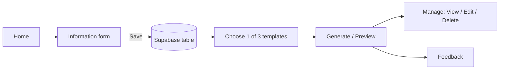
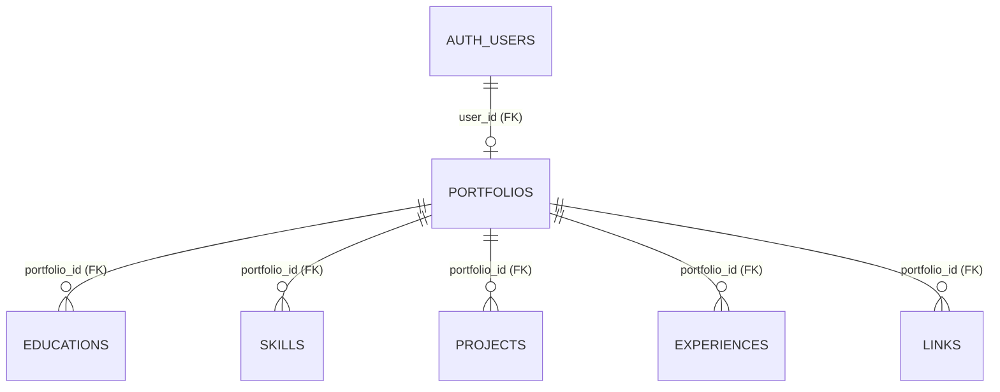
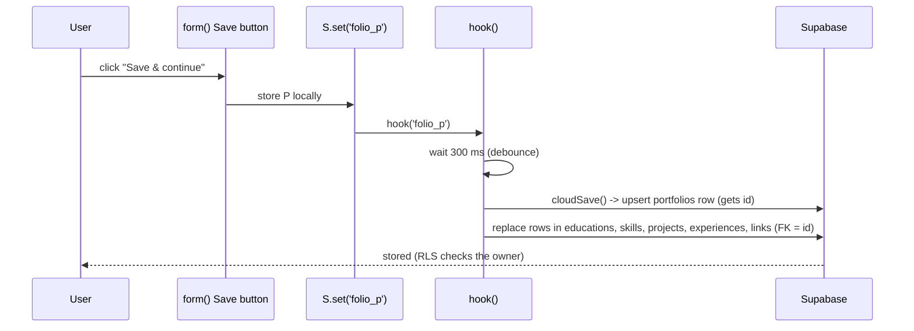

# Folio – Online Portfolio Template Generator

Folio lets a visitor enter their details, save them to an **online database (Supabase)**, choose one of **3 resume templates**, preview the result, and then **edit or delete** it. It is a static website (plain HTML, CSS and JavaScript, no framework or build step) hosted on **GitHub Pages**.

- **Live URL:** parabkurt-cymk.github.io/Folio
- **Database:** Supabase (PostgreSQL), project: Folio
- **Hosting:** GitHub Pages


[](https://developer.mozilla.org/en-US/docs/Web/HTML) [](https://developer.mozilla.org/en-US/docs/Web/CSS) []

---

## 1. Project files

| File | What it does |
|---|---|
| `index.html` | The page shell: a header (`<nav>`), an empty `<main id="app">` where every page is drawn, a footer, and the script tags. |
| `style.css` | All design: colors, layouts, the 3 resume templates, animations, dark mode, mobile rules. |
| `script.js` | All logic: page routing, form, template rendering, database calls, animations that need JavaScript. |
| `config.js` | Holds the Supabase project URL and the public (publishable/anon) key. **Never put a secret key here.** |
| `schema.sql` | Creates the 6 tables with their primary and foreign keys and the security rules. Run once in the Supabase SQL Editor. |

Load order in `index.html`: Supabase library (CDN, pinned version) → `config.js` → `script.js`. `config.js` must come before `script.js` because the script reads `window.SUPABASE_CONFIG` as soon as it starts.

---

## 2. How the app works (the big picture)

Folio is a **single-page app**. There is only one HTML file. Each "page" is a JavaScript function that writes HTML into `<main id="app">`.



### 2.1 Hash router (`route()`)
The address ends in `#home`, `#form`, `#templates`, `#preview`, `#manage`, `#feedback` or `#design`. When the hash changes, `route()` runs:

1. Reads `location.hash` and finds the matching page function (`home()`, `form()`, `templates()`, `preview()`, `manage()`, `feedback()`, `design()`).
2. Calls it, which replaces the contents of `#app`.
3. Highlights the active menu link and moves the sliding highlight (`moveInd()`).
4. Inserts the 3-step tracker (Information → Template → Preview) on the form, template and preview pages.

Because pages are drawn by JavaScript, nothing reloads when you navigate, and CSS animations replay on every page change.

### 2.2 Where the data lives
The portfolio is kept in one JavaScript object `P`:

```js
{ pic, name, email, phone, address, about, edu, skills, proj, exp, links }
```

The chosen template number is kept in `tpl` (1, 2 or 3). `S` is a tiny helper around `localStorage` (with a memory fallback) used for the local copy and for small settings:

| Key | Stores |
|---|---|
| `folio_p` | the portfolio `P` |
| `folio_t` | the chosen template number |
| `folio_a` | the chosen accent color |
| `folio_th` | light/dark theme |
| `folio_f` | submitted feedback |

---

## 3. The database flow (Supabase)

### 3.1 Table structure and keys (`schema.sql`)

The database has **6 tables**. A **portfolio** is the parent table. Education, skills, projects, experiences and links are **child tables**, linked to it by a foreign key. This is a **one-to-many** relationship: one portfolio has many education entries, many projects, and so on.



| Table | Columns | PK | FK |
|---|---|---|---|
| `portfolios` | id, user_id, full_name, email, phone, address, about, photo, template (1–3), created_at, updated_at | `id` | `user_id` → `auth.users(id)` (unique: one portfolio per visitor) |
| `educations` | id, portfolio_id, school, years, position | `id` | `portfolio_id` → `portfolios(id)` |
| `skills` | id, portfolio_id, name, position | `id` | `portfolio_id` → `portfolios(id)` |
| `projects` | id, portfolio_id, title, description, position | `id` | `portfolio_id` → `portfolios(id)` |
| `experiences` | id, portfolio_id, role, years, position | `id` | `portfolio_id` → `portfolios(id)` |
| `links` | id, portfolio_id, label, url, position | `id` | `portfolio_id` → `portfolios(id)` |

- **Primary key (PK):** `id` in every table is unique and never empty, so each row can be identified.
- **Foreign key (FK):** `portfolio_id` points to a real row in `portfolios`. The database refuses a child row whose portfolio does not exist.
- **`on delete cascade`:** deleting a portfolio automatically deletes all of its education, skills, projects, experiences and links.
- **`position`:** remembers the order of the rows, so lists come back in the order the user typed them.

### 3.2 Security
- **Anonymous sign-in:** the first time someone opens the site, `userId()` calls `sb.auth.signInAnonymously()`. Supabase gives that browser a private user ID without any login screen.
- **Row Level Security (RLS)** is switched on for all tables. On `portfolios`, 4 policies (select / insert / update / delete) say `auth.uid() = user_id`. On each child table, one policy only allows a row if its parent portfolio belongs to the visitor. So a visitor can only read, change or delete **their own data**, even though the public key is visible in the page.
- The public (anon/publishable) key is safe to publish. The secret/service_role key is never used.

### 3.3 The code that talks to the database (top of `script.js`)

| Function | Job |
|---|---|
| `sb` | The Supabase client. It is `null` if `config.js` still has placeholder text, so the site falls back to browser-only storage. |
| `CHILD` | Splits the form text into rows for each child table (for example `Task App \| To-do app` becomes `title = Task App`, `description = To-do app`). |
| `fromRows(r)` | The reverse: joins the rows from the child tables back into the text the form and templates use. |
| `userId()` | Returns the current user ID, signing in anonymously if needed. |
| `cloudInit()` | **Retrieve.** On page load: selects this user's portfolio **with all child rows in one query** (`select('*, educations(*), skills(*), ...')`, which Supabase can do because of the foreign keys). Fills `P` and `tpl`, then the page is redrawn. |
| `cloudSave()` | **Add + Save + Edit.** (1) `upsert` the `portfolios` row (insert the first time, update afterwards) and get its `id`. (2) For each child table: delete its old rows for that `portfolio_id`, then insert the current rows with their `position`. |
| `cloudDelete()` | **Delete.** Deletes the visitor's `portfolios` row. The foreign keys with `on delete cascade` remove all child rows automatically. |
| `hook(key, isDelete)` | Called by the storage helper `S` every time the app saves or deletes locally. It connects the app to the database (see below). |

### 3.4 How a save travels



The 300 ms **debounce** (`clearTimeout` + `setTimeout`) means rapid changes, such as picking a template and then clicking Generate, are combined into one database request.

### 3.5 CRUD summary

| Operation | Where it happens | Database call |
|---|---|---|
| Add / Save | `form()` Save button | `upsert` on `portfolios`, then `insert` into the child tables |
| Retrieve | page load, `cloudInit()` | one `select` with the child tables embedded |
| Edit | Edit button → `form()` → Save | `upsert` (update) + replace child rows |
| Delete | `manage()` Delete button | `delete` on `portfolios` (children cascade) |
| Template choice | `templates()` | `upsert` (updates `template`) |

**To verify:** after saving, open Supabase → Table Editor → `portfolios` to see the row. Refreshing the site, or clearing the browser's local storage, still brings the data back because `cloudInit()` reloads it from the database.

---

## 4. Unique parts of the code

### 4.1 The Information form (`form()`)
- A **progress bar** (`prog()`) counts how many of 11 items are filled (10 fields + photo) and sets the bar width as a percentage on every `input` event.
- **Profile picture:** the chosen file is read with `FileReader`, drawn onto a `<canvas>` scaled so the longest side is at most 320 px, and exported with `canvas.toDataURL('image/jpeg', .82)`. This keeps the stored image small enough for the database.
- **Example panel (right side):** `EX` holds an example for each field and `HT` holds a hint. A single `focusin` listener on the document calls `showEx(field)` when you click a field, so the panel always matches the field you are in. The **Use this example** button copies the example into the field.

### 4.2 Add/remove rows for Education, Projects, Experience and Links
Each of these sections is a list of rows with two boxes (for example "Project title" and "Short description").

- A **hidden `<textarea id="f_edu">`** (and the same for the others) is the real source of truth. It stores one item per line in the format `Title | Details`.
- `build(k)` reads that text with `lines()` (splits it by line and by the `|`) and draws one row per item, plus a **+ Add** button and a **✕** remove button.
- `sync(k)` does the reverse: whenever you type, it reads all rows and writes them back to the hidden textarea as `Title | Details` lines. Any `|` typed by the user is replaced with `/` so it cannot break the format.

This keeps the rest of the app (saving, database, templates) simple, because every list is just text.

### 4.3 The three templates (`render()` / `render0()`)
`render0(p, t)` builds the portfolio HTML for template number `t` from the data object `p`:

1. `lines()` splits education/projects/experience/links into `{t, d}` items (title, details).
2. `L()` turns items into `<div class="it"><b>title</b><span>details</span></div>`.
3. `K()` turns links into safe `<a>` tags; only URLs starting with `http` are made clickable.
4. `esc()` escapes `& < > "` in everything the user typed, so nobody can inject HTML into the page.
5. An `if` on `t` returns the markup for the chosen template: **Classic** (one-column resume), **Modern** (sidebar with photo) or **Professional** (header banner + side column).

If no photo was uploaded, a circle with the first letter of the name (`ini`) is shown instead (`av`).

### 4.4 Accent colors
`render()` wraps `render0()`. If an accent color is saved (`folio_a`), it adds `style="--pa:#color"` to the template's root element. In CSS the templates use `var(--pa, defaultColor)` for headings, lines and the header, so one variable recolors the whole resume without any extra code.

### 4.5 Live template previews that "shrink" (`fit()`)
Every template is designed at **800 px wide**. For the small preview cards, the full template is placed inside a box and shrunk with CSS `transform: scale(...)`:

```js
const s = v.clientWidth / 800;          // box width ÷ template width
c.style.transform = `scale(${s})`;      // shrink the template
```

`fit()` also sets the box height from the scaled height (capped at 300 px) and runs again when the window is resized. `pointer-events:none` stops the tiny preview from being clicked.

### 4.6 The scrolling template strip on the home page
This is **pure CSS**, with no JavaScript animation:

1. `home()` outputs the three templates **twice** in one row: `[1,2,3,1,2,3].map(...)`. Each is a `.mc` card (340 px wide) containing a scaled-down template.
2. The row `.mt` is a flexbox with `width:max-content`, so it is as wide as all six cards.
3. It moves with a CSS animation:

```css
.mt{display:flex;gap:18px;width:max-content;animation:mq 30s linear infinite}
@keyframes mq{to{transform:translateX(calc(-50% - 9px))}}
```

4. The strip slides left by **exactly half its width** (the first three cards). At that moment the second set of cards sits exactly where the first set started, so when the animation restarts the jump is invisible. That is what makes the loop look endless. (The extra `9px` is half the `18px` gap.)
5. `.mq:hover .mt{animation-play-state:paused}` pauses it on hover.
6. A `mask-image: linear-gradient(...)` on the container fades the left and right edges.

### 4.7 Header animations
- **Sliding highlight (`#ind` + `moveInd()`):** one absolutely-positioned element sits behind the menu. After every route change, `moveInd()` sets its `left` and `width` to match the active link, and a CSS `transition` makes it glide. It also scrolls the menu so the active link stays visible on phones.
- **Menu on mobile:** the links live in `.nl` (`overflow-x:auto`), so only the links scroll sideways while the "Folio." logo stays fixed.
- **Intro animation:** the header and links use `@keyframes navin` and `linkin` with staggered `animation-delay`.

### 4.8 Page and button animations
- **Page transitions:** CSS `#app > *{animation: rise ...}` plays whenever a page is drawn, with `:nth-child` delays so sections appear one after another.
- **Button ripple:** one click listener on the document finds the clicked `button`/`.btn`, adds a `<span class="rp">` at the cursor position, plays `@keyframes ripple`, and removes it after 650 ms.
- **Toasts:** `toast(text)` shows a small message that uses `@keyframes toast`.
- `prefers-reduced-motion` turns all of these animations off for people who prefer less motion.

### 4.9 Theme and design toggles
- **Dark mode:** colors are CSS variables on `:root` (`--bg`, `--fg`, `--card`, `--brand`...). Dark values are applied by `@media (prefers-color-scheme: dark)` and by `data-theme="dark"`. The ◐ button flips `document.documentElement.dataset.theme` and remembers it (`folio_th`).
- **Design annotations (the "Aa" button):** it toggles `body.ann`. Elements marked with `data-el="Line · Unity"` get a dashed red outline and a label drawn from `attr(data-el)` using `::after`. The **Design** page documents how each element and principle of visual design is applied.

### 4.10 Feedback page (`feedback()`)
Collects a star rating, which template to improve, requested features and comments. It builds a text summary and stores it under `folio_f` in the browser (it is not sent to the database), with a **Copy summary** button.

### 4.11 Responsiveness
`style.css` uses `grid`/`flex` with `minmax`, plus `@media (max-width: 700px)` rules to stack the template columns, shrink spacing and make the menu scrollable. The resume templates have separate mobile rules scoped to `.frame` so the scaled previews (which stay 800 px wide) are not affected.

---

## 5. The Setup

1. Created a Supabase project. Under **Authentication → Sign In / Providers**, turned on **Allow anonymous sign-ins**.
2. Opened **SQL Editor**, pasted `schema.sql` and clicked **Run** (it first deletes any older version of these tables). Checked that all 6 tables show RLS enabled.
3. Put the **Project URL** and **publishable/anon key** in `config.js`.
4. Pushed all files to GitHub (with `index.html` at the root). Turned on **Settings → Pages** (branch `main`, folder `/root`).
5. Opened the link. And the banner on the Information page should say "Connected".

## 6. Testing checklist
1. Open the site and click **Create Portfolio**.
2. Fill in the form and **Save**; check the new row in Supabase.
3. Choose each of the 3 templates and open the preview.
4. Refresh the page; the data should still be there.
5. Edit a field, save again, and check that the same row updated.
6. Delete from **Manage**; the row should disappear from Supabase.

## 7. Limitations
- There is no login, so a portfolio belongs to one browser. A different browser or device starts with an empty portfolio.
- Saving replaces all child rows each time instead of changing only the rows that changed (simple, but not the most efficient).
- Feedback is stored in the browser only.

## 8. Notes
Built and helped with AI assistance (Claude), then tested and customized by us student(Frontend).